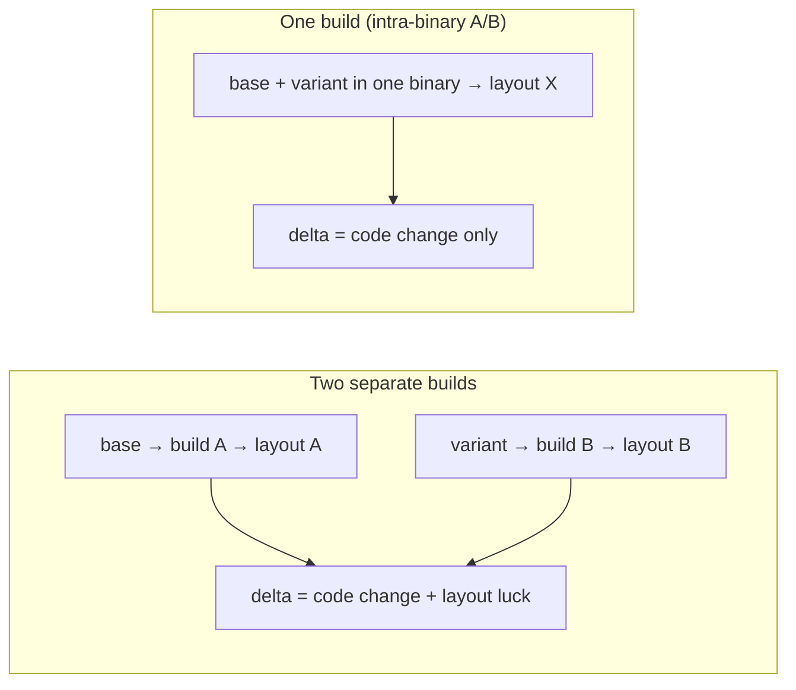
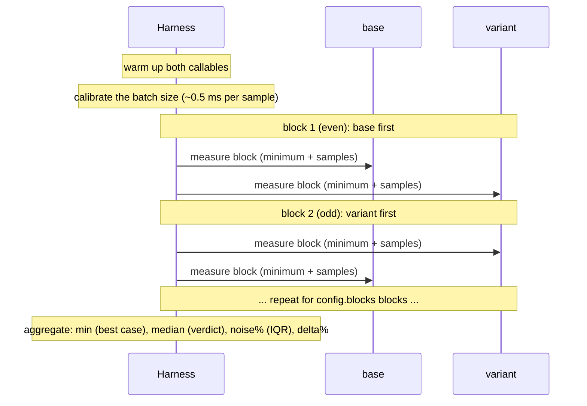

# Intra-binary A/B microbenchmarks

A small harness for comparing **two implementations of the same operation** (an A/B pair) inside a single process, without code-layout effects polluting the measured difference.

## Why this exists

Microbenchmarks of hot, tight code are sensitive to **code layout**: rebuilding after an unrelated code change can move the reported `min`/`median` by 5–10%, because the hot loop shifted by a cache line (the "layout lottery"). This makes it hard to distinguish a real optimization from layout luck, especially on MSVC, which has no function-alignment knob.

The harness removes this source of error by construction: the **base and variant** implementations are compiled into the same binary and measured in the same process. Any layout effect of that build affects both equally, so the measured *difference* is immune to it. Alternating blocks also cancel slow machine drift.



This is the recommended tool for validating **function-level** optimizations (e.g. *does `std::to_chars` beat `std::to_string` here? does `__forceinline` help this loop?*).

> [!IMPORTANT]
> Intra-binary A/B compares **two versions of one code path**. It does **not** compare different libraries against each other, and it cannot detect whole-translation-unit / whole-binary code-generation effects. Those must be validated with the full round-trip benchmark — see [CONTRIBUTING.md — Performance Benchmarks](../../CONTRIBUTING.md#performance-benchmarks).

## How it works

For each registered pair:

1. Both implementations are warmed up (not measured).
2. The measurement is split into `blocks` alternating blocks: `base, variant, variant, base, ...` (the order flips every block, so slow machine drift affects both equally).
3. In each block, each implementation runs for `measurePerBlock` and its **minimum per-call time** is kept (best case, matching the archives benchmark). Calls are batched adaptively so the clock overhead is amortized.
4. The result is:
   - `baseMinNs` / `variantMinNs` — best per-call time of each implementation;
   - `baseMedianNs` / `variantMedianNs` — median per-call time;
   - `speedDeltaPct` — relative throughput change from the minimums `(base / variant − 1) * 100` (**positive = the variant is faster**);
   - `medianSpeedDeltaPct` — the same from the medians; the verdict is based on it (the min is an extreme-value statistic). If it disagrees with the min-based value in sign, the result is `~noise`;
   - `noisePct` — interquartile spread of the per-block deltas (a robust noise band);
   - `significant` — the median delta exceeds both the noise band and a threshold (default 1 percentage point), and the min agrees in sign.

The pipeline for one pair:



The order is reversed on every block (base→variant, then variant→base) so both implementations see the same slow drift in machine state. Because they share one binary, any code-layout effect applies to both equally.

## Measurement precision

For each implementation the harness runs:

1. **Warm-up** — `Config::warmup` (default **200 ms**), not measured. It stabilizes the CPU frequency, caches and branch predictors for that code path. The example also calls `BenchHarness::PrepareEnvironment()` once (priority, core pinning and a 1 s CPU warm-up) to move the CPU out of a low-power state.
2. **Calibration** — the callable runs until at least **~50 µs** have elapsed (≈500 clock ticks), counting calls. This gives a per-call estimate accurate to about one tick; it is used *only* to size the batch, so it does not need to be exact. The batch is then chosen so that one timed sample lasts **~0.5 ms**.
3. **Measurement** — for each of `Config::blocks` alternating blocks (default **9**), the implementation runs for `Config::measurePerBlock` (default **100 ms**). Every sample times `batch` calls and divides by the batch. The reported values are the overall **minimum** (best case) and the **median** per-call time; the verdict is based on the median.

For a ~10 ns operation this is roughly `batch ≈ 50 000` calls per sample, `~200` samples per block and `~90 million` calls per implementation — easily enough to resolve a sub-percent effect.

### Why the 100 ns clock tick does not limit accuracy

On Windows `std::chrono::steady_clock` is `QueryPerformanceCounter`: a **10 MHz** counter, i.e. **100 ns per tick** (two consecutive `now()` calls usually return the same value). Timing a *single* 10 ns call directly against such a clock would incur a ±1-tick quantization of ±1000%.

The harness avoids this by timing a **batch of ~0.5 ms (≈5000 ticks)** and dividing by the batch size. The ±1-tick error becomes ~0.02% of the sample — negligible. Consequently:

- **No "wait for the next tick" before starting.** A partial tick at the start costs at most 100 ns out of ~500 000 ns (0.02%), while CPU/cache jitter is a few tenths of a percent to ~2%. Tick alignment would not move the needle.
- **No end-phase correction.** The measured interval is already an integer number of ticks; the residual phase is ≤1 tick (0.02% of a sample) and sits far below the noise floor. There is also no need to calibrate "ns per tick" during warm-up: the counter *is* ticks, and `duration_cast` to nanoseconds is exact (in 100 ns steps).

In short: **batching, not tick alignment, buys the precision** — the residual noise comes from the processor, not the clock.

### Choosing the time (recipes)

The defaults are already conservative: **9 blocks × 100 ms** (~2 s per pair) with a **200 ms warm-up**. On a quiet machine this gives ~0.05-0.1 pp repeatability, and even a 5 × 100 ms run (~1 s) is close — for most contributors there is nothing to tune; run the example as is.

The limit is usually the **machine**, not the sample count. A five-machine sweep of the same workload (standard deviation of the delta over 10 runs):

| machine | 0.3 s | 2 s | 6 s |
|---|---|---|---|
| quiet (Ryzen 5700X, Arch Linux, GCC 16) | 0.07 pp | 0.06 pp | 0.07 pp |
| quiet (i5-4308U, Arch Linux, GCC 16) | 0.03 pp | 0.04 pp | 0.10 pp |
| quiet (Ryzen 9900X3D, Windows work machine, apps + download) | 0.14 pp | 0.07 pp | 0.05 pp |
| medium (Pentium Gold 7505, OpenBSD, clang 22) | 0.14 pp | 0.16 pp | 0.16 pp |
| busy (Ryzen 5900X, 10-year-old Windows install) | 0.25 pp | 0.19 pp | 0.24 pp |

The floor is dominated by the **OS/background**, not the CPU: a Zen 3 (5700X) and even a 2014 Haswell ultrabook (i5-4308U) on a clean Linux both reach ~0.1 pp or better, while the same Zen 3 generation on a 10-year-old Windows install stays at ~0.2-0.4 pp. A normal Windows work machine (many apps and a download in the background, but no heavy load) is still quiet (~0.1 pp), and a low-power 2-core CPU on OpenBSD lands in between (~0.2 pp). Longer runs help only up to ~1-2 s, and on a busy machine they do not help at all.

- `noise%` is the spread *within* one run. Run the pair 2-3 times: if the delta moves more between runs than `noise%` (e.g. OpenBSD showed ~0.1 pp within a run but ~0.2 pp between runs), use the larger spread as the band;
- if that band is large (roughly ≳0.5 pp), the machine is the problem: reduce background load or use another machine, do not just increase the time;
- only trust a delta larger than the band; otherwise the result is `~noise`;
- on a quiet machine the defaults (or `--blocks 5`) are plenty; `--blocks 15` tightens the noise estimate only marginally.

Recommendation: **about 1 s per pair** (e.g. `--blocks 9 --block-ms 50` or `--blocks 5 --block-ms 100`) is enough; keep the default for critical comparisons. The min-based and median-based deltas can differ by ~1 pp for small effects, so a sub-1 pp result should not be over-trusted.

## Usage

Include `bench_harness.h` (part of the `bench_harness` target) and register base/variant callables. The complete example:

```cpp
#include <charconv>
#include <cstdint>
#include <string>

#include "bench_harness.h"
#include "perf_utils.h"

namespace
{
	volatile std::uint64_t gSink = 0;      // prevent the optimizer from removing work
	volatile std::uint64_t gInput = 123456789;
	std::string gText = "123456789";
}

int main(int argc, char* argv[])
{
	BenchHarness::Config config;
	if (!BenchHarness::ParseConfig(argc, argv, config))
	{
		return 0;
	}

	BenchHarness::PrepareEnvironment();

	char buffer[32];
	BenchHarness::Runner runner(config);

	runner.Add("uint64 -> string: to_string vs to_chars",
		[&] {
			const std::uint64_t value = gInput;
			const std::string result = std::to_string(value);
			gSink += result.size();
		},
		[&] {
			const std::uint64_t value = gInput;
			const auto result = std::to_chars(buffer, buffer + sizeof(buffer), value);
			gSink += static_cast<std::uint64_t>(result.ptr - buffer);
		});

	runner.Add("string -> uint64: stoull vs from_chars",
		[&] {
			gSink += std::stoull(gText);
		},
		[&] {
			std::uint64_t parsed = 0;
			std::from_chars(gText.data(), gText.data() + gText.size(), parsed);
			gSink += parsed;
		});

	// Sanity check: identical implementations must be reported as "~noise".
	runner.Add("null A/B (identical implementations)",
		[&] {
			const std::uint64_t value = gInput;
			const std::string result = std::to_string(value);
			gSink += result.size();
		},
		[&] {
			const std::uint64_t value = gInput;
			const std::string result = std::to_string(value);
			gSink += result.size();
		});

	runner.RunAll();
	if (runner.HasRegression())
	{
		return 1;
	}
	return 0;
}
```

Output:

```
Intra-binary A/B microbenchmark (9 blocks x 100 ms, warmup 200 ms)
                                           base ns(min/med)  var ns(min/med)  speed%(min/med)  noise%  verdict
  uint64 -> string: to_string vs to_chars       11.03/11.20      10.56/10.71      +4.39/+4.56    0.45  FASTER
  string -> uint64: stoull vs from_chars        26.47/26.99        5.71/5.75  +363.22/+369.69    0.00  FASTER
  null A/B (identical implementations)          11.00/11.19      11.10/11.18      -0.84/+0.08    0.12  ~noise
```

### Recommendations

- **Use the same process environment as the archives benchmark**: call `BenchHarness::PrepareEnvironment()` before running — it raises priority, pins the thread to a fixed core and warms up the CPU (see the [Usage](#usage) example).
- **Tune the time if needed.** `--blocks`, `--block-ms` and `--warmup-ms` override the defaults (see `BenchHarness::ParseConfig`); see [Choosing the time (recipes)](#choosing-the-time-recipes).
- **Give the callable real, observable work.** Accumulate into a `volatile` sink, or write to a buffer that outlives the call.
- **Keep one unit of work per call.** For very cheap operations the harness already batches internally; do not wrap your own loop unless the loop is part of what you are measuring.
- **Prefer more blocks / longer blocks for small effects.** `9 × 100 ms` per pair (about 2 s) is a good default; increase `blocks` if a few-percent delta must be resolved.
- **Run it with both MSVC and Clang.** Absolute numbers differ between compilers; compare only deltas measured with the same compiler and flags. Because the two implementations share the layout, the *delta* is stable on MSVC as well — this is the main advantage over comparing two separately-built executables.

### Archive Save/Load A/B

The harness also covers the **full archive pipeline** on a small model — useful when you want to A/B two archive instantiations (two independent archives, or the same archive with one component swapped) without running the heavy round-trip benchmark:

- `benchmark_models.h` provides a set of small models — `MixedBenchmarkModel`, `NumericBenchmarkModel`, `StringBenchmarkModel`, `EscapedBenchmarkModel`, `Utf8BenchmarkModel`, `EscapedKeyBenchmarkModel` — each with a generic `Serialize()` method. Running several profiles shows whether a result depends on the workload (numbers vs strings vs escaped vs UTF-8, and escaped keys).
- `archive_ab.cpp` (target `archive_ab_benchmarks`) is a ready-made example that compares two instantiations of the built-in JSON archive — strict JSON (`JsonArchive`) vs JSONC (`JsoncArchive`) — for Save and Load over all model profiles. They share every component except the format trait, so it also demonstrates the **component-swap** pattern: both versions coexist in one binary, with no fork of the whole archive.

```cmd
cmake -GNinja -B build -DCMAKE_BUILD_TYPE=Release -DBUILD_MICROBENCHMARKS=ON -DBUILD_JSON_ARCHIVE=ON -DCMAKE_TOOLCHAIN_FILE=%VCPKG_ROOT%/scripts/buildsystems/vcpkg.cmake
ninja -C build archive_ab_benchmarks
build\bin\archive_ab_benchmarks.exe --models mixed
build\bin\archive_ab_benchmarks.exe --models mixed,strings
build\bin\archive_ab_benchmarks.exe --models mixed,numeric,strings,escaped,utf8,escaped-keys
build\bin\archive_ab_benchmarks.exe --list
```

By default it runs only the `mixed` profile; use `--models <name[,name...]>` to pick others, `--models all` for the full set, and `--list` to see the available names. The full list is `mixed`, `numeric`, `strings`, `escaped`, `utf8`, `escaped-keys` (the same set as `--models all`). All selected models are printed in one table.

The example is templated on the two archive types, so swapping the variant is one line:

```cpp
using BaseArchive = BitSerializer::Json::JsonArchive;
using VariantArchive = BitSerializer::Json::JsoncArchive;
// or your own instantiation that differs only in the changed component:
// using VariantArchive = BitSerializer::ArchiveBase<
//     BitSerializer::Detail::JsonArchiveTraits<BitSerializer::ArchiveType::Json>,
//     BitSerializer::Detail::JsonReadRootScope<BitSerializer::ArchiveType::Json>,
//     MyModifiedWriteScope<BitSerializer::ArchiveType::Json>>;
```

Notes:

- **Save** compares two serializers on the same model; **Load** must read each archive's *own* output (produce the buffers beforehand), exactly as the round-trip benchmark does per archive.
- Use it for **A/B**, not for absolute throughput: a small model has a larger fixed-overhead fraction. The round-trip benchmark remains the source of truth for the published numbers/chart.
- The bundled JSON-vs-JSONC run is a real example: Save is ~identical (JSONC output is plain JSON), while Load is ~5% slower for JSONC (its parser handles comments and trailing commas). Replace the variant with your own component to measure your change.
- **CSV requires an array root**, so wrap the model in a container (e.g. `std::array`) for CSV; the other archives accept the object root directly.
- To compare an **old vs new implementation of one archive**, swap only the changed component (traits, scope, or a policy/template parameter) and instantiate two `ArchiveBase<...>` types — do **not** fork the whole archive. See [Tier 2](#tier-2--archive-level-ab-when-the-change-spans-the-pipeline).

## Optimizing an archive (A/B workflow)

Use this three-tier protocol. Each tier answers a different question and is progressively more expensive.

### Tier 1 — function-level A/B (default for micro-optimizations)

For a hot function (string escaping, number formatting, a scan loop):

1. Copy the current implementation next to the benchmark as the **base**.
2. Add the proposed implementation as the **variant** in the same translation unit.
3. Feed representative inputs and assert that both produce identical output.
4. Measure with `BenchHarness::Runner` (~2 s per direction, layout-robust).
5. Iterate on the variant until the gain is clearly above the noise band.

`microbenchmark.cpp` (target `microbenchmark`) is a worked example: it pitches the current SIMD escape scan and the current `reserve+append` fast path of the JSON string writer against alternatives. It includes the archive's internal header on purpose — that is the function being optimized.

### Tier 2 — archive-level A/B (when the change spans the pipeline)

If the change cannot be isolated (it touches dispatch or several functions), compare two archive instantiations on a small model — see [Archive Save/Load A/B](#archive-saveload-ab) and `archive_ab.cpp`. This confirms that the micro-win survives the real wiring.

The archive is assembled from components (`ArchiveBase<Traits, ReadScope, WriteScope>`), so swap only the changed one and let both instantiations coexist:

```cpp
using BaseArchive = BitSerializer::Json::JsonArchive;
using VariantArchive = BitSerializer::ArchiveBase<
    BitSerializer::Detail::JsonArchiveTraits<BitSerializer::ArchiveType::Json>,
    BitSerializer::Detail::JsonReadRootScope<BitSerializer::ArchiveType::Json>,
    MyModifiedWriteScope<BitSerializer::ArchiveType::Json>>;
```

If the change is a **policy/template parameter** (e.g. a writer policy), instantiate the policy twice instead of writing a second component.

> Do **not** copy the whole archive just for an A/B. A full copy drifts from the original and is a maintenance trap. If the change is in dispatch or otherwise cannot be isolated into a component, use Tier 3 (round-trip with alignment) or a temporary experimental fork that is **not** committed.

### Tier 3 — end-to-end validation (before committing)

Run the round-trip `archives_benchmark` for the affected archive and stage (Clang/GCC with function alignment; MSVC is indicative). This catches whole-TU codegen effects that a Tier 1/2 win can mask.

### Rules

- Compare under the same compiler and flags; never mix absolute numbers.
- A result is meaningful only when it is `significant` (median delta above the noise band, and the min agrees in sign).
- If a Tier 1 win does not reproduce in Tier 3, do not commit it.

### Worked example (what this buys you)

`microbenchmark.cpp` compares the JSON string writer against two alternatives. Running it on both compilers shows why per-compiler validation matters:

- Replacing the SIMD escape scan with a scalar loop is **10–87% slower** — the SIMD scan is essential.
- Replacing `reserve+append` with `resize+memcpy` is **faster on MSVC** but **substantially slower on Clang for long strings** (Clang does not eliminate the `resize` zero-fill). It was therefore not landed; a compiler-specific win needs a guard rather than a blanket change.

Lesson: run the A/B on every compiler you care about — a win on one can be a loss on another.

## Building

The harness (`bench_harness.h`) is header-only; it is provided by the `bench_harness` target, which also compiles `perf_utils.cpp` (`benchmarks/harness/`). The bundled `microbenchmark` example is built when `BUILD_MICROBENCHMARKS` and `BUILD_JSON_ARCHIVE` are enabled (it includes the JSON writer's internal header):

```cmd
cmake -GNinja -B build -DCMAKE_BUILD_TYPE=Release -DBUILD_MICROBENCHMARKS=ON -DBUILD_JSON_ARCHIVE=ON -DCMAKE_TOOLCHAIN_FILE=%VCPKG_ROOT%/scripts/buildsystems/vcpkg.cmake
ninja -C build microbenchmark
build\bin\microbenchmark.exe
```

The example is only a template — copy its structure into a new target when adding microbenchmarks for a specific component, or reuse `BenchHarness::Runner` directly.

## Relationship to the archives benchmark

| Tool | Answers | Layout-robust? |
|---|---|---|
| `archives_benchmarks` (round-trip) | "How fast is the whole save/load pipeline across archives?" | Only with Clang/GCC function alignment |
| `microbenchmark` (this harness) | "Is this specific function/implementation faster than that one?" | Yes (intra-binary) |

For the background, see [CONTRIBUTING.md — Code-layout sensitivity](../../CONTRIBUTING.md#code-layout-sensitivity-and-the-toolchain-rule).
