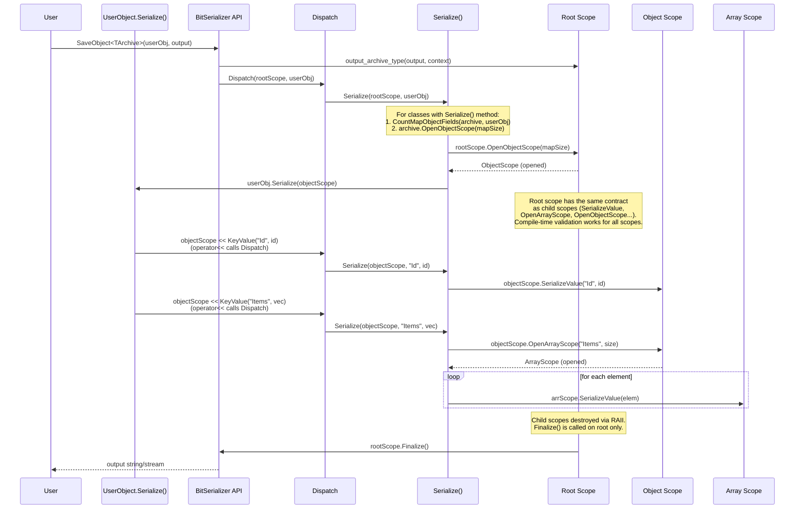

### [BitSerializer](../../README.md) / Architecture

### Overview

The library uses an **archive pattern**: each format provides `input_archive_type` (deserialization) and `output_archive_type` (serialization). `BitSerializer::LoadObject<TArchive>()` / `SaveObject<TArchive>()` dispatch values through `Detail::Dispatch()`, which routes fundamentals, STD containers, KeyValue pairs, and custom classes to the correct `Serialize()` overload.

The code example below serializes a `User` object — the diagram that follows visualizes the same flow step by step:

```cpp
struct User
{
    int Id = 0;
    std::string Name;
    std::vector<std::string> Tags;

    template <class TArchive>
    void Serialize(TArchive& archive)
    {
        archive << KeyValue("Id", Id);
        archive << KeyValue("Name", Name);
        archive << KeyValue("Tags", Tags);
    }
};

// Usage:
std::string output;
BitSerializer::SaveObject<JsonArchive>(user, output);
```



### Archive Traits

Each archive declares capabilities via a traits struct (e.g. `JsonArchiveTraits`). Archives are assembled via `ArchiveBase<Traits, ReadRootScope, WriteRootScope>` which sets `input_archive_type` / `output_archive_type`.

| Trait | Role |
|-------|------|
| `preferred_output_type` | Default buffer type for serialized output (`std::string`) |
| `string_view_type` | Canonical string view for I/O (`std::string_view`) |
| `is_binary` | Whether format is binary (`true` for MsgPack) |
| `require_array_size` / `require_map_size` | Whether size must be known before writing |

Stream support is determined at compile-time via `is_archive_support_{input,output}_data_type_v` (checks `is_constructible_v` of root scope with `(stream, SerializationContext&)`). If an archive lacks stream constructors, `bit_serializer.h` applies a fallback: **Load** → read stream into `preferred_output_type`, verify UTF-8, skip BOM, delegate to string `LoadObject`; **Save** → serialize to `preferred_output_type`, write optional BOM + data to stream. Only `char` streams and UTF-8 are supported in the fallback.

### Archive scope contract

A **scope** is a short-lived RAII object responsible for serializing the current node (object, array, or binary blob) in the archive. It does not own child scopes — each nested node creates its own scope, and when all nested elements are serialized, the parent scope's destructor finalizes the node. Root, object, and array scopes each implement the same core interface. Scopes inherit from both the archive traits and `ArchiveScope<SerializeMode>`, which provides `GetMode()`, `IsSaving()`, `IsLoading()`, `GetContext()`, `GetOptions()`, and the opened/not-opened state (`IsOpened()`, `operator bool`).

`Open*Scope()` returns the concrete scope **by value**. A scope is either *opened* or *not opened*: when the node cannot be opened (for example a type mismatch while loading), the returned scope is in the not-opened state, so `IsOpened()`/`operator bool` yield `false` and the scope performs no operation on destruction.

| Method | Scope types | Mode | Description |
|--------|------------|------|-------------|
| `IsOpened()` / `operator bool` | All | Both | Whether the scope was successfully opened |
| `GetPath()` | All | Both | Current path in archive (for error messages) |
| `SerializeValue(T& value)` | Root, Array, Binary | Both | Serialize next value |
| `SerializeValue(TKey&& key, T& value)` | Object | Both | Serialize value by key |
| `OpenArrayScope(...)` | Root, Array, Object | Both | Open nested array |
| `OpenObjectScope(...)` | Root, Array, Object | Both | Open nested object |
| `OpenBinaryScope(...)` | Root, Array, Object | Both | Open nested binary (if supported) |
| `Finalize()` | Root only | Both | Called after serialization completes |
| `GetEstimatedSize()` | Array, Object, Binary | Load | Element count for container reserve |
| `IsEnd()` | Array, Binary | Load | `true` when all elements read |
| `VisitKeys(TCallback&&)` | Object | Load | Enumerates all keys (re-seeks to start) |

All scopes, including root, implement the same contract — the combination of methods (`SerializeValue`, `OpenArrayScope`, `OpenObjectScope`) which enables **compile-time format validation**. For example, CSV root only has `OpenArrayScope()` (no `SerializeValue()`), so serializing a primitive at root level is a compile error. See `serialization_detail/serialization_dispatch.h` and the respective archive headers for details.

### Loading semantics: arrays and objects

These rules are part of the archive contract and are locked by the shared test helpers (`TestSkippedArrayValues`, `TestMismatchedArrayValue`, `TestMismatchedFieldPolicy` in `src/testing_tools/common_test_methods.h`).

**Array scopes** (sequences) map **one archive slot to one target slot**, regardless of whether the value was successfully converted:

- `SerializeValue()` / `Open*Scope()` consume the current slot even when the value is *skipped* — a `null` value or a value rejected by `MismatchedTypesPolicy::Skip` / `OverflowNumberPolicy::Skip`.
- The slot counter used by `IsEnd()` (and, for text formats, the read of the next value separator) is advanced for every consumed slot, so a skipped value never shifts the following values.
- The target slot is left untouched: an element of a fixed C-array or of a pre-filled container keeps its previous value; a newly created element of a dynamic container stays default-constructed. `Skip` means "ignore the value", not "remove/compact the container element" (arity is preserved).
- A fixed-size array must consume exactly `N` slots; a mismatch between the number of slots in the archive and the target size is reported as `SerializationException(OutOfRange)`.
- Nested scopes follow the same rule: a skipped nested array/object consumes one parent slot.

Example: loading `[null, 5]` into `int[2]` (or `std::vector<int>`) leaves the first element unchanged (or default-initialized) and loads `5` into the second one.

**Object scopes** (key-value maps) are key-driven:

- `SerializeValue(key, value)` / `Open*Scope(key, ...)` look up the key by name; the order of keys in the archive is irrelevant. Unknown keys are skipped.
- If the key is missing, the target is left unchanged and the call returns `false`; use `KeyValue(..., Required())` to report a validation error instead.
- A value with a mismatched type follows `MismatchedTypesPolicy`: `ThrowError` (the default) throws, `Skip` leaves the target unchanged and consumes the key-value pair.
- Null values are excluded from `MismatchedTypesPolicy` and are simply skipped (same as in arrays).
- Remaining key-value pairs are skipped when the object scope is destroyed, so a partially loaded object does not desynchronize the archive.

### Archive type alias

The top-level archive (e.g., `MsgPackArchive`) is a type alias that specializes `ArchiveBase` with the archive's traits and root scope classes:

```cpp
using MsgPackArchive = ArchiveBase<
    Detail::MsgPackArchiveTraits,
    Detail::MsgPackReadRootScope,
    Detail::MsgPackWriteRootScope
>;
```

`ArchiveBase` inherits the traits struct and provides:
- Traits constants (`archive_type`, `key_type`, `is_binary`, `require_array_size`, etc.)
- `input_archive_type` — root scope class for deserialization
- `output_archive_type` — root scope class for serialization
